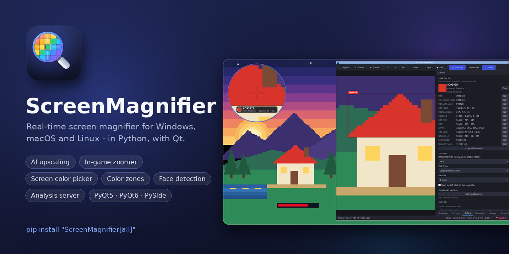
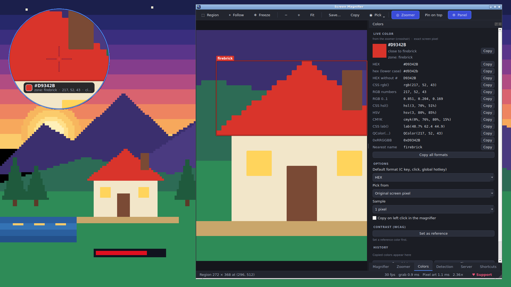

# ScreenMagnifier

<p align="center"></p>

A real-time screen magnifier written in Python with **PyQt/PySide** through
[ManyQt](https://github.com/Usama01TN/ManyQt): select any screen region (or follow the mouse
cursor), zoom from 0.25× to 32×, and upscale the live image with classic or AI super-resolution
filters. Color detection, optional AI face detection and an optional analysis server (upscaling and analysis
on another computer, in real time) are built in.



*The magnifier (Pixel art upscaler, 2.4x) outlines the red roof as a color zone; the zoomer, pinned on it, shows its
live color code and zone; the Colors tab follows the same live color. Captured from the running application.*

## Goal:

Inspect small UI details, read tiny text, check pixel alignment and pick colours, with an image that
stays sharp at high magnification instead of turning into a blurry or blocky mess.

## In-advanced zoom (works while you play):

Start the app (optionally straight into the tray with `python main.py --tray`), switch to your game and press:

| Global hotkey           | Action                                                                   |
|-------------------------|--------------------------------------------------------------------------|
| **Ctrl+Alt+Z**          | Show / hide the zoom lens                                                |
| Ctrl+Alt+= / Ctrl+Alt+- | Zoom in / out (1x - 16x)                                                 |
| Ctrl+Alt+X              | Pin the target at the current mouse position                             |
| Ctrl+Alt+C              | Cycle the target: screen centre -> pinned point -> mouse cursor          |
| Ctrl+Alt+K              | Copy the zoomer color code (when *Color code under the crosshair* is on) |
| Ctrl+Alt+P              | Screen color picker: live zoom at the mouse, click anywhere to copy      |

All hotkeys - and every window shortcut - are rebindable in the **Shortcuts** tab (click a field, press the new
combination) and every
setting is saved between launches.

- The lens is **click-through and never takes focus**: the game keeps receiving every key and mouse click,
  even clicks made directly on the lens.
- **Target**: screen centre (your crosshair), a pinned point (e.g. the minimap), or the mouse cursor.
- **Placement**: *On target* (scope style, the lens sits over what it magnifies), any screen corner
  (picture-in-picture), next to the target, a **custom area** or **full screen**. Circle, rounded square (with an
  adjustable **corner radius**, 0-200 px: square corners to pill / circle) or rectangle, size 160-900 px,
  opacity, crosshair, 15-144 fps.
- **Filters** (Zoomer tab): Grayscale, Sepia, Invert, High contrast, Warm (less blue light), Night vision,
  Thermal (false colors), Outline (edges) and **color-blindness help** (red-, green- or blue-weak), with a
  Strength slider, plus Brightness / Contrast / Saturation. The copied color code stays the true screen color.
  The color-blindness filters keep whites and greys unchanged; on random colors they cut the pairs a red-,
  green- or blue-weak viewer confuses by 20 %, 38 % and 67 % (measured with a standard simulation, not with
  viewers - the picture looks unusual to typical vision; Strength softens it).
- **Custom area**: *Draw the area on the screen...* and drag a rectangle anywhere (any size and aspect ratio),
  or type its position and size. The magnified area follows the shape of the lens.
- **Full screen**: the lens covers a whole screen (the screen of the target, or one you choose) - a full-screen
  zoom for games and videos. Press the zoomer shortcut (Ctrl+Alt+Z) to hide it. A lens that covers what it
  magnifies must be hidden from screen capture: Windows 10 (2004+) / 11 does it; elsewhere a full-screen lens
  moves to **your other screen** automatically (two monitors: screen 1 magnified on screen 2), or to a corner
  with one screen.
- Closing the window keeps the app running in the **system tray**; right-click the tray icon -> Quit to exit.
  The main magnifier stops capturing while hidden, so only the lens costs CPU while you play.
- The lens uses the upscaler selected in the Settings tab (AI super-resolution by default when available).

Requirements and limits:

- Run the game in **borderless / windowed full-screen**. Exclusive full-screen bypasses the desktop
  compositor and no overlay can be drawn over it.
- *On target* (scope) placement must never capture the lens itself. The app tries, in order:
    1. **Hide the lens from capture** (Windows 10 2004+ / 11), verified with a tiny 16 px probe pattern.
       The lens is a constant-alpha window: Windows refuses (error 8) to hide per-pixel-alpha windows.
    2. **Capture the game window directly** (PrintWindow, like OBS "Window Capture"): the lens floats above
       the game window, so it can never appear in that capture, whatever Windows says about hiding.
    3. Otherwise the lens moves to a free corner. The *Zoomer* tab always shows which mode is active
       and why. On Linux / macOS the corner is used.
- Troubleshooting on Windows: run `python wincheck.py` and send its 4-line report.
- On Windows the hotkey combination is consumed (the game does not see it). With pynput (Linux / macOS)
  the game also receives it, so pick combinations your game does not use. On Wayland, global hotkeys
  and screen capture need XWayland (`QT_QPA_PLATFORM=xcb`); on macOS grant Accessibility and Screen
  Recording permissions.
- Some competitive games forbid screen-zoom tools in their rules or anti-cheat; check before using it online.

## Color codes (color picker):

**One live color, one text everywhere.** Whatever you point at is *the* live color - the magnifier while the mouse
is over it, otherwise the zoomer crosshair (when its color code is on), the screen color picker while it runs. The
*Colors* tab (**LIVE COLOR**, with where it comes from), the zoomer color code and the eyedropper bubble show it
with the same code - in the *default copy format* (e.g. `rgb(225, 16, 32)`), so **the code shown is always the code
copied** - the same color name and the same color zone. *Pick from* tells whether codes come from the zoomed image
or the exact screen pixel (the screen color picker is always pixel-exact).

Copy the color code of any pixel to the clipboard - from the real screen, live, without the window:

- **Screen color picker - Ctrl+Alt+P anywhere** (any application or game; also *Pick from screen* in the toolbar,
  Ctrl+Shift+P): a pixel-exact zoom lens with a pixel grid follows the mouse beside the cursor and shows the **live**
  color of the pixel under the crosshair (swatch, HEX, RGB) on every frame. **Left click anywhere** copies
  it (the click does not reach the application underneath), **Ctrl+Alt+P** again copies too, **right-click / Esc**
  cancels, the **wheel** zooms, the **arrow keys** move the cursor by 1 px (Linux). The exact screen pixel at the
  click is copied, in the default format, and added to the history. Click capture: X11 pointer grab on Linux, a
  low-level mouse hook on Windows, an event tap on macOS (needs the *Accessibility* permission, like the hotkeys).
- **Zoomer color code (optional)**: *Zoomer* tab -> *Color tools in the zoomer* -> *Color code under the crosshair*
  (off by default) shows the live HEX / RGB of the crosshair pixel - and the name of the color zone it is in, when
  *Color zones* is on too. **Ctrl+Alt+K** copies exactly the code shown (same pick source and sample size as the
  *Colors* tab); with the color code off, the hotkey copies nothing and says why.
- **Pick color** (toolbar, **I**): eyedropper on the zoomed screen - a bubble shows the color under the cursor,
  every click copies it (no panning while picking), **Esc** stops. Colors are read from the **zoomed image as you
  see it** (after upscaling, sharpening, inversion); *Pick from: Original screen pixel* in the *Colors* tab reads
  the untouched screen pixel instead. Every way of copying below follows that choice.
- **C**: copies the color under the mouse in the magnifier, in the default format.
- **Right-click** in the magnifier: menu with the color in every format (default format first).
- **Left click** (optional, *Colors* tab): copy on click. Detection's *Pick* mode takes precedence.
- **Ctrl+Alt+P anywhere**: the screen color picker above (rebindable in the *Shortcuts* tab).
- **13 formats**: `#3A7BD5`, `#3a7bd5`, `3A7BD5`, `rgb(58, 123, 213)`, `58, 123, 213`,
  `0.227, 0.482, 0.835`, `hsl(215, 65%, 53%)`, `hsv(215, 73%, 84%)`, `cmyk(73%, 42%, 0%, 16%)`,
  `lab(51.7% 9.7 -52.3)`, `QColor(58, 123, 213)`, `0x3A7BD5`, `cornflowerblue` - or *Copy all formats*.
- **Sample**: 1 pixel, or the average of 3 x 3, 5 x 5 or 9 x 9 pixels (steadier on anti-aliased text and
  textures).
- **Confirmation**: an animated "#3A7BD5 copied" bubble with a swatch, in the magnifier or in the lens.
- **History**: the last 32 copied colors as swatches (click: copy again, right-click: remove), kept between
  sessions; *Copy history* copies them all.
- The *Colors* tab also shows the color under the mouse in every format, each with its own *Copy* button, and
  the WCAG contrast checker.

## Color detection:

*Detection* tab -> **Detect target colors**.

- **Target colors**: *Add...* (color dialog) or *Pick* + a click in the magnifier. The click is refined: on
  thin text or icon edges (anti-aliased, pale pixels) and in noisy images, the object's typical color is used,
  so clicking anywhere on a red word gives the same result.
- **Match: Similar shades** (default): same hue at any lightness - shading, shadows, highlights and
  anti-aliased text of the target color all match; tolerance = hue in degrees (15 by default). Grey, white and
  black targets match similar neutral pixels. Muted look-alikes (e.g. brown for red) need strong evidence (hysteresis),
  so they do not produce false boxes.
- **Match: Exact color**: only colors within a delta E distance (CIE Lab), e.g. to check one precise UI color.
  Use it too when "every shade" is too broad (a red-tinted photo contains many shades of red).
- **Group nearby** (5 px): the letters and words of a text line, or a noisy object, form one box; thin strokes (1 px
  text, lines) are kept; isolated noise pixels are ignored.
- **Moving content**: boxes and the mask stay locked onto the screen content in follow-cursor mode and in the
  Zoomer lens (each result carries the screen position of its frame).
- **Highlight mask**: *Isolate* dims everything that does not match, *Tint* paints the matches with a vivid
  complementary color.
- **Dominant colors**: a stable palette bar (no flicker between frames) with names and shares.
- **Color codes and contrast**: see *Color codes* above (*Colors* tab).
- **Alerts**: a status bar (or tray, while you play) message when a target color appears.
- **Where**: *Show the zones in: the magnifier / the zoomer* (Detection tab) - independent switches; the zoomer one
  is the same setting as *Color zones* in the Zoomer tab.

Measured on test scenes with exact ground truth (anti-aliased red text, 1 px line, button, icon, a shaded red
sphere, a red cube in shadow, a noisy health bar, and pink / orange / magenta / brown look-alikes): 100 % of the
red objects found, one box per object, no false matches; 173 different click positions on the objects: no
false boxes. About 15-30 ms per 800x500 frame on a worker thread; unchanged frames are not analysed again.
With the analysis server, frames travel losslessly (exact colors).

## Face detection (optional AI):

*Detection* tab -> **Detect faces** (off by default).

- **YuNet** (OpenCV DNN, MIT license): accurate, confidence score and 5 landmarks. The 232 KB model is
  downloaded once with *Download model* from the official OpenCV model zoo and verified with SHA-256 before
  use (`python server.py --download-face-model` does the same for a server).
- **Haar cascade**: ships with opencv-python, works immediately, frontal faces only. Local contrast
  equalisation (CLAHE): letterbox bars or a plain desktop around a video do not hide the faces.
- **Modes**: boxes, boxes + landmarks, or **privacy blur** (pixelates every face in the magnifier and lens).

### Face pointer (watching films)

*Detection* tab -> **Follow the faces on the screen**, or **Ctrl+Alt+F** anywhere: the mouse pointer glides to
the faces of the film (the largest one, or the one nearest the pointer), and stays with a face while it moves.

- **What follows the face**: the mouse pointer, or **only the zoomer** - the zoomer magnifies the face and the
  pointer stays still (video players show their controls when the pointer moves).
- Move the mouse yourself to take the control back: it pauses (1-10 s, your choice), then follows again.
- The whole screen of the pointer is scanned a few times per second in the background (faces from ~48 px on a
  1080p screen with Haar; the YuNet model finds smaller faces, faster). This application's windows and the
  zoomer lens are ignored, so a magnified face is never chased.
- Wayland, and macOS without the Accessibility permission, do not let applications move the pointer: the
  face pointer says so - choose *Only the zoomer* there.

**Offline games** (*How to move*):

- **Automatic** (default): moves the pointer (films, menus) and **centres the enemy's face on the screen** while a
  game captures the mouse - the system says the pointer is confined (Windows) or hidden while it is moved (a
  resting video player shows it again), or the game puts it back on the same spot. When a menu shows the pointer
  again, the pointer is moved again.
- Games that show a pointer (strategy, adventure, top-down): *Move the pointer to the face*.
- Games that capture the mouse (first-person, 3D): *Turn the view to the face* sends mouse movements, like a real
  mouse, until the face is at the crosshair (the screen centre), in real time (~30 times per second): the area
  around the crosshair is captured at full resolution; once a face is followed, it is tracked around its expected
  position.
- The game's mouse sensitivity is **measured from the picture** (how far the scene turns for the movements sent,
  over ~0.5 s; inverted axes included): no calibration, from very low to very high sensitivities.
- *When*: **While the right mouse button is held** (aim) assists only then, so your own aiming is never fought.
- **Assist area** around the crosshair: faces farther away are ignored. A face that does not move with the view (a
  portrait of the game's interface) is recognised and ignored for a few seconds, and a safety limit prevents
  any runaway turn.
- The status says what is wrong: the game's picture cannot be captured (run it borderless / windowed; on Windows
  `pip install dxcam` captures more games), or the game does not receive the movements (click into it; a game
  running as administrator needs Screen Magnifier as administrator too).
- Aims at the **head** (between the eyes with YuNet, eye level with Haar), not the centre of the face, and keeps
  tracking it: a walking enemy's own motion is measured (its motion on screen minus the view's turn) and led. The
  enemy's body is left out of the view's motion measurement.
- Enemies seen from behind are not found (the detectors find faces, not people).
- The detectors are trained on real faces: realistic characters work best, stylised or cartoon faces poorly.

## Analysis server:

Upscaling and analysis can run on another (stronger) computer in real time:

```bash
# On the computer that does the work (always use a token on a network):
ScreenMagnifierServer --host 0.0.0.0 --port 8765 --token SECRET
```

The server is **pure Python - no Qt** - so it also runs on a **phone or tablet** (Android: Termux or Pydroid),
a Raspberry Pi or a headless Linux box. It needs only NumPy; optional packages add features:

| Installed            | Upscaling methods                 | Colors                                  | Faces | Images accepted |
|----------------------|-----------------------------------|-----------------------------------------|-------|-----------------|
| NumPy                | Nearest, Bilinear, Pixel art      | yes (one box per color)                 | -     | RAWZ (lossless) |
| + SciPy              | same                              | yes (separate regions, same as desktop) | -     | RAWZ            |
| + OpenCV             | all, AI super-resolution included | yes                                     | yes   | RAWZ, PNG, JPEG |
| + Pillow (no OpenCV) | as above without OpenCV           | as above                                | -     | RAWZ, PNG, JPEG |

```bash
# Android (Termux): install Python + NumPy (+ SciPy), then the package without its desktop dependencies
pkg install python python-numpy python-scipy
pip install --no-deps ScreenMagnifier
python -m ScreenMagnifier.server --host 0.0.0.0 --token SECRET
python -m ScreenMagnifier.server --selftest        # checks the installation (prints "ok")
```

The server tells the application which image formats it decodes: when it has no JPEG codec, the application
sends lossless RAWZ instead (more bandwidth, exact pixels).

Then in the *Server* tab: host, port, token -> **Connect**, and choose what to offload: upscaling of the
magnifier, upscaling of the Zoomer lens, color / face analysis. *Start local server* runs one on this
computer (for testing).

- **Never blocks the view**: at most one request per stream is in flight ("latest frame wins"); until the
  server answers, the view shows its last result or a quick local scale. A slow network adds latency, never a
  growing backlog.
- **Server upscaling method**: the one of the Settings tab, or any method the server offers (it may have AI
  models this computer has not).
- **Image quality**: *Balanced* (JPEG 92-95, near lossless), *Fast* (JPEG 85), *Lossless* (PNG, exact
  pixels for pixel inspection, more bandwidth).
- **Robust**: automatic reconnection, wrong tokens refused (no retry loop), local fallback while the server
  is gone, protocol limits against malformed data (sizes, and compressed images cannot inflate beyond their
  declared size).
- **Live statistics**: latency, frames per second per stream, upload / download rate.

Performance depends on the network and both computers. Measured in a single-core test machine running client,
server and display together: 85 ms latency and 9 server frames per second for a 680x512 region; separate
computers with more cores do better.

## Key features:

- **Region selection**: full-desktop freeze overlay (all monitors), drag to select, pixel loupe with
  coordinates and colour, arrow keys nudge the cursor by 1 px (Shift: 10 px), Esc / right-click cancels.
- **Follow-cursor mode**: the magnifier tracks the mouse pointer; the capture size automatically matches
  what the view can show at the current zoom.
- **Adjustable magnification**: 0.25× - 32× via mouse wheel (zooms around the cursor), logarithmic
  slider, presets (1×, 2×, 4×, 8×, 16×), keyboard (+ / - / 0) and double-click to fit.
- **Real-time upscaling**: only the visible crop is upscaled, straight to on-screen size (HiDPI aware):

  | Method                           | Needs          | Typical cost (200×150 → 800×600) |
  |----------------------------------|----------------|----------------------------------|
  | Nearest (pixel-perfect)          | -              | < 1 ms                           |
  | Bilinear                         | -              | ~2 ms                            |
  | Bicubic, Lanczos                 | OpenCV         | 3-6 ms                           |
  | Pixel art (Scale2x / EPX)        | NumPy          | ~5 ms                            |
  | AI super-res fast (FSRCNN-small) | opencv-contrib | ~10 ms                           |
  | AI super-res quality (FSRCNN)    | opencv-contrib | ~30 ms                           |

  An adjustable unsharp mask (0-200 %) can be applied after smooth methods.
  Missing optional libraries simply hide the methods that need them.
- **Inspection overlays**: pixel grid from 10×, hovered-pixel outline, crosshair, colour inversion,
  live colour picker in the status bar (screen coordinates, hex and RGB).
- **Freeze, Save, Copy**: pause the capture to study a frame; save or copy the whole region upscaled at
  the current magnification (PNG / JPEG).
- **Multi-monitor & HiDPI**: regions spanning several screens are composed; frames are physical pixels.
- **No "hall of mirrors"**: on Windows 10 2004+ the magnifier hides itself from screen capture
  (`SetWindowDisplayAffinity`), so it can sit over what it magnifies. Elsewhere, capture pauses while the
  cursor is over the magnifier in follow mode.
- **Binding-agnostic**: all Qt imports go through ManyQt. Tested with PyQt5 5.15 and PyQt6 6.11.

## Download:

Ready-to-run builds for **Windows, macOS and Linux, x64 and ARM64** are attached to every
[GitHub release](../../releases) (`ScreenMagnifier-<version>-<os>-<arch>`), with `SHA256SUMS.txt`. Each archive
holds the application and the headless server (`ScreenMagnifierServer`). No Python needed.

- **Windows**: unzip, run `ScreenMagnifier.exe` (SmartScreen may warn about an unsigned app: *More info* -> *Run*).
- **macOS**: unzip, right-click `ScreenMagnifier.app` -> *Open* the first time (unsigned app), then allow *Screen
  Recording* (and *Accessibility* for global hotkeys) in System Settings.
- **Linux**: `tar xzf ScreenMagnifier-*.tar.gz && ScreenMagnifier/ScreenMagnifier` (X11 / XWayland).
- The Windows ARM64 build has no OpenCV (no wheel exists): Qt upscaling and color detection work, face detection
  and the OpenCV upscalers are unavailable.

## Installation:

With **pip** (Python 3.8+) - choose the Qt binding with an extra:

```bash
pip install "ScreenMagnifier[all]"            # PyQt6 + OpenCV: every feature
pip install "ScreenMagnifier[pyqt5,opencv]"   # or [pyqt5] / [pyqt6] / [pyside6], with or without OpenCV
ScreenMagnifier                                # start it (or: python -m ScreenMagnifier)
ScreenMagnifierServer --port 8765            # the headless analysis server
```

| Extra                         | Installs                                                            |
|-------------------------------|---------------------------------------------------------------------|
| `pyqt6` / `pyqt5` / `pyside6` | the Qt binding (one is required; ManyQt runs on any of them)        |
| `opencv`                      | OpenCV (headless): Bicubic / Lanczos / AI upscaling, face detection |
| `all`                         | PyQt6 + OpenCV                                                      |

- **From the repository**: `pip install ".[all]"` - or `pip install -e ".[all]"` to develop (edits apply at once),
  then `pytest tests`.
- **From a release**: the GitHub release also holds the wheel:
  `pip install "screenmagnifier-<version>-py3-none-any.whl[all]"`.
- **Without installing**: `pip install -r requirements.txt` plus a Qt binding, then `python -m ScreenMagnifier`
  in the repository folder (each component also runs alone: `python ScreenMagnifier/upscaler/main.py`).
- With several Qt bindings installed, choose one with `QT_API`: `QT_API=pyqt6 ScreenMagnifier`. Without any, the
  command says which extra to install.
- **As a library**: `from ScreenMagnifier import Upscaler, ColorDetector, MagnifierViewWidget, ZoomOverlay` (every
  component is importable; each is loaded on first use).

## Languages:

The interface speaks **12 languages**:

|                               |                              |                |                    |
|-------------------------------|------------------------------|----------------|--------------------|
| English (`en`)                | Français (`fr`)              | Español (`es`) | Deutsch (`de`)     |
| Italiano (`it`)               | Português (Brasil) (`pt_BR`) | Русский (`ru`) | Türkçe (`tr`)      |
| العربية (`ar`, right-to-left) | 日本語 (`ja`)                | 한국어 (`ko`)  | 简体中文 (`zh_CN`) |

By default it follows the system language (with regional fallbacks: `pt_PT` uses Português (Brasil), `zh_TW` uses
简体中文, `de_AT` uses Deutsch). Choose another with the **🌐 language button** at the right of the status bar (the
change applies on restart, offered right away) or once from the command line: `ScreenMagnifier --lang ja`. The
common names `jp`, `cn`, `kr` and `pt` work too. Every panel fits at the default size in every language: long texts
wrap instead of being cut off.

On Linux, Japanese, Korean and Chinese need a CJK font (Windows and macOS have one):
`sudo apt install fonts-noto-cjk` (Debian / Ubuntu) or `sudo dnf install google-noto-sans-cjk-fonts` (Fedora).

Translations are plain JSON catalogs - `ScreenMagnifier/translations/<code>.json`, `{"English text": "translation"}`

- loaded by a small `QTranslator` (the `translator` component): no Qt tools needed, the same files for PyQt5, PyQt6
  and PySide. Qt's own dialogs follow the language too.

**Add or update a language** (texts left empty stay in English until translated):

```bash
python .github/packaging/translations.py --new it Italiano     # start a catalog, with every text to translate
python .github/packaging/translations.py --update             # after code changes: add new texts, drop old ones
python .github/packaging/translations.py --check              # complete? {} placeholders and icons kept?
```

The workflow runs `--check` on every push, and `pytest tests` checks every language through Qt.

## Features and tabs:

| Tab           | Feature                                                                                                   |
|---------------|-----------------------------------------------------------------------------------------------------------|
| **Magnifier** | magnification, upscaling, sharpening, frame rate, overlays of the main view                               |
| **Zoomer**    | the in-game zoom lens (target, placement, look) and its **color tools**: color code, color zones          |
| **Colors**    | how colors are copied everywhere: format, pick source (zoomed / original), sample size, history, contrast |
| **Detection** | what is detected: target colors, matching, faces, palette, alerts; where the zones are shown              |
| **Server**    | remote upscaling / analysis                                                                               |
| **Shortcuts** | every keyboard shortcut of every feature, editable, with conflict detection                               |

## Keyboard shortcuts:

Every shortcut is listed - and changed - in the **Shortcuts** tab: click a field, press the keys, done (window
shortcuts also have an alternate key). Conflicts are flagged live: red = the same keys twice in one scope, orange
= a window shortcut equal to a global hotkey (the global hotkey takes it). Global hotkeys are suspended while you
record one; each shows whether the system accepted it. Per-row and global reset to the defaults below.

## Window shortcuts:

| Key                       | Action                                               |
|---------------------------|------------------------------------------------------|
| Ctrl+R                    | Select region                                        |
| F                         | Follow cursor on / off                               |
| Space                     | Freeze / resume                                      |
| + / - / 0                 | Zoom in / out / fit                                  |
| Wheel, drag, double-click | Zoom at cursor, pan, fit                             |
| Ctrl+S / Ctrl+C           | Save / copy the upscaled region                      |
| I / Esc                   | Eyedropper on / off (click the zoomed image to copy) |
| Ctrl+Shift+P              | Screen color picker                                  |
| C / right-click           | Copy the color code under the mouse / in any format  |
| T                         | Pin on top                                           |
| Ctrl+,                    | Show / hide settings                                 |
| Ctrl+Q                    | Quit (closing the window only hides it to the tray)  |

## Repository layout:

```
ScreenMagnifier/                 the repository
├── setup.py, pyproject.toml, MANIFEST.in, requirements.txt, README.md
├── tests/                       pytest suite (pip install -e ".[all]" && pytest tests)
├── .github/                     FUNDING.yml, workflows/build-release.yml, packaging/ (release builds)
├── docs/                        icon / banner / screenshot (sources and generators)
└── ScreenMagnifier/             the package: import ScreenMagnifier
    ├── __init__.py, __main__.py, main.py, mainwindow.py, server.py, ...
    └── upscaler/, colordetector/, zoomoverlay/, ...   one feature per subpackage, each with a demo
```

Importing the package never changes `sys.path`; the standalone demos (`python <component>/main.py`) still work.

## Artwork:

`docs/` holds the editable sources: `icon.svg` (48 px and larger) and `icon-small.svg` (16 - 32 px: a simplified
drawing, fine detail turns to mush at those sizes), `banner.png` (1280 x 640: also the size of GitHub's *social
preview*, set in the repository *Settings*), `screenshot.png`, and the scripts that rebuild them -
`make_icons.py` (PNG 16 - 512, Windows `.ico`, macOS `.icns` into `ScreenMagnifier/resources/`),
`make_screenshot.py` (captures the real application over an original pixel-art scene) and `make_banner.py`.

## Contents:

Every package is standalone (no imports between sibling packages) and runnable on its own with
`python <package>/main.py`.

**Capture:**

- `regionselector/` - `RegionSelector`: frozen-desktop overlay emitting `regionSelected(QRect)`.
- `screengrabber/` - `ScreenGrabber`: timer-driven capture of a fixed region or the area around the
  cursor, emitting `frameReady(QImage)`.

**Processing:**

- `upscaler/` - `Upscaler`: `process(QImage, QSize) -> QImage` with seven methods + sharpening.
  `upscaler/models/` ships the FSRCNN networks (Apache-2.0, from
  [Saafke/FSRCNN_Tensorflow](https://github.com/Saafke/FSRCNN_Tensorflow)).

**Advanced overlay:**

- `shortcuteditor/` - `ShortcutEditorWidget`: grouped, searchable shortcut editor (window + global scopes, alternate
  keys, live conflict detection, registration status, reset), `shortcutChanged`, `recordingChanged`.
- `mousecatcher/` - `GlobalMouseCatcher`: catches (and swallows) clicks anywhere on the screen - X11 grab, Windows
  low-level hook, macOS event tap - with `clicked(QPoint, int)`, `wheelTurned(int)`, `keyPressed(int)`.
- `hotkeys/` - `GlobalHotkeys`: system-wide shortcuts (Win32 `RegisterHotKey` thread, pynput elsewhere),
  emitting `activated(name)`.
- `zoomoverlay/` - `ZoomOverlay`: click-through, focus-less, top-most lens fed with `setFrame()`; tells the
  capture code what to grab with `sourceRect()`.

**Detection:**

- `colorswatches/` - `ColorSwatchesWidget`: grid of color swatches (history), `colorClicked(QColor)`,
  right-click removal, newest first.
- `colordetector/` - `ColorDetector`: `analyze(QImage) -> dict` (regions, coverage, palette, label mask) plus
  `colorInfo`, `nearestColorName`, `contrastRatio`, `wcagRating`, `maskToOverlay`, `formatColor` (13 color
  code formats, `COLOR_FORMATS`) and `sampleColor` (averaged pick).
- `facedetector/` - `FaceDetector`: `detect(QImage) -> dict` with YuNet / Haar backends and the verified
  on-demand model download (`downloadModel()`, `downloadProgress`, `downloadFinished`).

**Network:**

- `netprotocol/` - `FrameChannel`, `FrameServer`: dependency-free framed messages over TCP (QtNetwork),
  JSON header + binary payload, size limits.

**Display:**

- `magnifierview/` - `MagnifierViewWidget`: zoom / pan view with a pluggable `processor` callable, grid,
  crosshair, inversion, zoom badge, `pixelHovered` / `pixelClicked(QPoint, QColor)` and annotations (`setAnnotations()`:
  boxes, labels, landmarks, privacy blur; `setOverlayImage()`: color mask).

**Application:**

- `controlpanel.py` - `ControlPanel`: settings dock bound to the view, the upscaler and the grabber.
- `advancedoverlay.py` - `AdvancedOverlayController`: hotkeys + lens + capture loop, settings persisted with QSettings.
- `advancedpanel.py` - `AdvancedOverlayPanel`: the *Zoomer* tab (target, placement, lens look).
- `analysiscontroller.py` - `AnalysisController`: rate-limited color / face analysis on a worker thread or on
  the server, turned into annotations; alerts.
- `shortcuts.py` - the registry of every shortcut (scope, group, defaults) + `ShortcutStore`; `shortcutspanel.py` -
  the *Shortcuts* tab. `features.py` - `FeatureSettings`: where the zones are shown (one state for every tab).
- `colorpanel.py` - `ColorPickerPanel`: the *Colors* tab (color codes, copy, history, contrast).
- `detectionpanel.py` - `DetectionPanel`: the *Detection* tab.
- `remoteclient.py` - `RemoteClient`, `RemoteProcessor`: server connection, latest-frame-wins requests,
  processor plugging the server into the view / lens.
- `serverpanel.py` - `ServerPanel`: the *Server* tab.
- `analysisserver.py` / `server.py` - `AnalysisServer` and its headless entry point.
- `mainwindow.py` / `main.py` - the application window and entry point (`--tray`, `--selftest`, `--version`);
  `__main__.py` - `python -m ScreenMagnifier`; `support.py` - donation links and the Qt binding check.
- `setup.py` / `pyproject.toml` / `MANIFEST.in` (repository root) - the pip package `ScreenMagnifier`; `tests/` -
  pytest suite of the installed package; `.github/FUNDING.yml` - GitHub's *Sponsor* button (checked by the
  workflow, which also puts its links in every release's notes).
- `.github/packaging/` - `build.py`, `ScreenMagnifier.spec`, `requirements-build.txt`: release builds (PyInstaller).

## Integration:

```python
from ScreenMagnifier import ScreenGrabber, Upscaler, MagnifierViewWidget

upscaler = Upscaler(method=Upscaler.Lanczos, sharpness=0.3)  # type: Upscaler
view = MagnifierViewWidget(zoom=4.0, processor=upscaler.process)  # type: MagnifierViewWidget
grabber = ScreenGrabber(fps=30, followCursor=True, frameReady=view.setFrame, autoStart=True)  # type: ScreenGrabber
upscaler.methodChanged.connect(view.refresh)
```

Color detection and a remote server in a few lines:

```python
from ScreenMagnifier import ColorDetector, RemoteClient

detector = ColorDetector(targetColors=['#E01020'], tolerance=20)  # type: ColorDetector
result = detector.analyze(image)  # {'detections': [{'rect': [x, y, w, h], 'name': 'crimson', ...}], ...}

client = RemoteClient(host='192.168.1.20', token='SECRET')  # type: RemoteClient
client.connectToServer()
view.setProcessor(client.processor('view', fallback=upscaler.process))  # Upscaled on the server.
client.upscaleReady.connect(lambda channel: view.refresh())
```

Each option is a constructor kwarg, a `getX()` / `setX()` pair (setters are slots) and a `pyqtProperty`.

## Platform notes:

- **Linux / Wayland**: most compositors block `QScreen.grabWindow`. Run under XWayland with
  `QT_QPA_PLATFORM=xcb python main.py`.
- **macOS**: grant *Screen Recording* permission to your terminal / Python, otherwise only the wallpaper
  is captured.
- **Zoomer with a very large lens at low zoom on a small screen**: if the lens overlaps the area it
  magnifies in every corner and the lens cannot be hidden from capture, part of the lens may show itself;
  use a smaller lens or a higher zoom.
- **Server security**: the token is a shared secret, not encryption. Keep the server on a trusted network (or behind an
  SSH tunnel / VPN). By default the server only listens on this computer (127.0.0.1).
- **Windows**: the self-exclusion also hides the magnifier from your own screenshots and screen
  sharing; pass `MainWindow(excludeFromCapture=False)` to disable it.

## Support:

If ScreenMagnifier is helpful and useful to you, a star on GitHub would mean a lot and helps others discover them. If you'd
like to support development further:

<p>
  <a href="https://ba9chich.com/fr/IninouUsama"></a>
  <a href="https://ko-fi.com/usamatn"></a>
</p>

- **Ba9chich (Leave a tip):** [ba9chich.com/fr/IninouUsama](https://ba9chich.com/fr/IninouUsama)
- **Ko-fi (Buy me a coffee for extra energy):** [ko-fi.com/usamatn](https://ko-fi.com/usamatn)

Thank you so much <3, have a nice day :)
